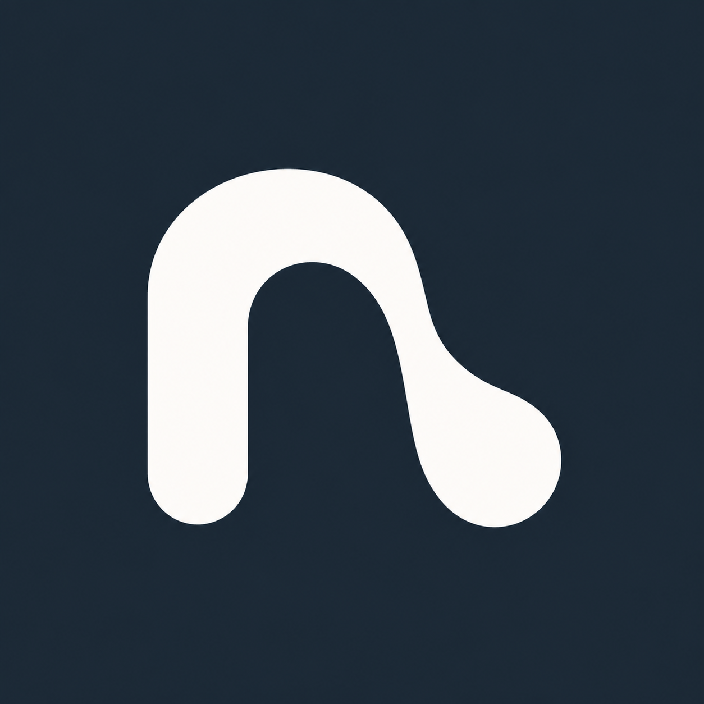

# NavGesture

> Edge gestures for Xiaomi HyperOS, so you can keep the launcher you actually like.

NavGesture is an edge-gesture app. It does four things:

- **Recents waits for a real pause.** Modelled on the stock POCO launcher (6.01.05), a pause only counts past POCO's own line (about a tenth of the screen up), and it is detected the way POCO detects it: a smoothed follow point catching up with the finger, not a timer. The pause only *arms* Recents, with a tick. Letting go decides, and a quick flick up is still Home.
- **A black drop rises from the edge** under your finger: a round head joined to the edge by a gooey metaball neck (adapted from Ramotion's MIT-licensed fluid slider), moved by Fluid Navigation Gestures' springs. The neck thins as the head pulls away, leans as you slide, and the drop wobbles once as it forms. From the bottom it carries a Home icon; from the sides it carries the Back arrow. The action fires as you let go. It never touches the app underneath.
- **Swipe up from the bottom and drag sideways** and a macOS-style row of app icons appears just above the edge: recent apps when you drag right, your favourites when you drag left. Home screens never appear. Each drag step (72 dp by default, adjustable) moves one icon, a finger resting between two apps does not flicker between them, and the row scrolls smoothly and loops at both ends. Lift to open, or swipe down to close. A plain upward swipe with no sideways drag is still Home, and a still pause is still Recents.
- **Tap to pick, if a long swipe is hard.** Set the list style to *Tap* and the list stays open after you lift your finger: touch an app to open it, or touch anywhere else to close. *Both* does either: slide to pick, or lift without sliding and touch.
- **Corner shortcuts.** Swipe up and inward from a bottom corner, at a slant, and that corner runs its shortcut: the app list, notifications, quick settings, a screenshot, lock screen, the power menu, split screen, or any app you pick. A corner without a shortcut keeps working as before.
- **Bank apps keep working.** Many bank and payment apps refuse to open while an Accessibility app is on. Pick them on the Bank apps screen: when one opens, NavGesture gives your phone its own bar back and steps aside, and a few seconds after you leave, gestures come back by themselves. Needs the same one-time computer permission as "hide the gesture bar", and usage access.

It installs as its own app (`com.vijayyaso.navgesture`).

HyperOS ties its gesture navigation to the stock launcher. Switch to Nova, Niagara or Lawnchair and the phone drops you back to three buttons. NavGesture brings the gestures back with one app, without root, ADB, Shizuku or a computer. It works on any phone with Android 11 or newer.

**[Download the latest release](https://github.com/vijayyaso/NavGesture/releases/latest)** · no root, no ADB, no computer needed

Two builds come from this code. The GitHub release can check GitHub for updates (off until you turn it on). The Google Play build, once published, has no internet permission and updates through Play.

## Gestures

| Gesture | Does |
| --- | --- |
| Swipe in from the left or right edge | Back |
| Swipe up from the bottom edge | Home |
| Swipe up from the bottom, pause, then let go | Recent apps |
| Swipe up from the bottom, then drag right | App list: recent apps, one per drag step, loops at both ends |
| Swipe up from the bottom, then drag left | App list: your favourites, one per drag step, loops at both ends |
| Swipe down while the app list is open | Closes the list; nothing opens |
| Swipe up and inward from a bottom corner | That corner's shortcut, once you pick one |
| Touch and hold the middle of the bottom edge | Circle to Search, once it is on |

In landscape the first bottom swipe only shows a pill, and a second one within 2 seconds goes Home, as HyperOS does in games. Every distance and delay is adjustable in the app's Gesture settings.

## Install

1. Install `navgesture.apk` from [the latest release](https://github.com/vijayyaso/NavGesture/releases/latest).
2. Allow restricted settings under Settings › Apps › NavGesture › ⋮ › **Allow restricted settings**.
3. Turn it on under Settings › Accessibility › **NavGesture**, then open the app. Its setup checklist covers the rest.

If Play Protect blocks the install, allow restricted settings as in step 2. If the gestures stop, the app's Troubleshooting screen has the fixes.

## Privacy

Gestures need an accessibility service. This one watches thin strips along the screen edges and turns a swipe into Back, Home, Recents or an app list. Its configuration withholds window content, and it takes no accessibility events unless you pick bank apps for bank pause, which tells it only when one of them opens. It never reads the screen or what you type. The app goes online only for an update check that stays off until you turn it on, and then asks GitHub for the latest release. It has no ads, analytics or account. The full [privacy policy](docs/privacy-policy.md) covers both builds.

## What it can't do

It can't switch on HyperOS's own gesture navigation, since only the system is allowed to do that. It can open the navigation settings so you can hide the three-button bar. [docs/hyperos-navigation.md](docs/hyperos-navigation.md) has the details, and [docs/development.md](docs/development.md) covers working on the code.

## Contributors

- Vijayyaso, NavGesture: Recents, the drop, the edge app list and the packaging
- Henrique Almeida ([@h3nc4](https://github.com/h3nc4)), the base of the gesture service
- Victor Eduardo ([@victoresidoro](https://github.com/victoresidoro)), Circle to Search, the Control Center tile, edge to edge and wrapping labels

Circle to Search starts the way [MiCTS](https://github.com/parallelcc/MiCTS) and [CTSLauncher](https://github.com/chenxiaolong/CTSLauncher) do.

## License

GPL-3.0-or-later, see [LICENSE](LICENSE). Copyright (C) 2026 Henrique Almeida and the contributors above. NavGesture is a modified version of [HyperGesture](https://github.com/h3nc4/HyperGesture) by Henrique Almeida. It was forked from HyperGesture commit `0ee6831` (2026-10-23) and has been changed by the NavGesture contributors since then.
