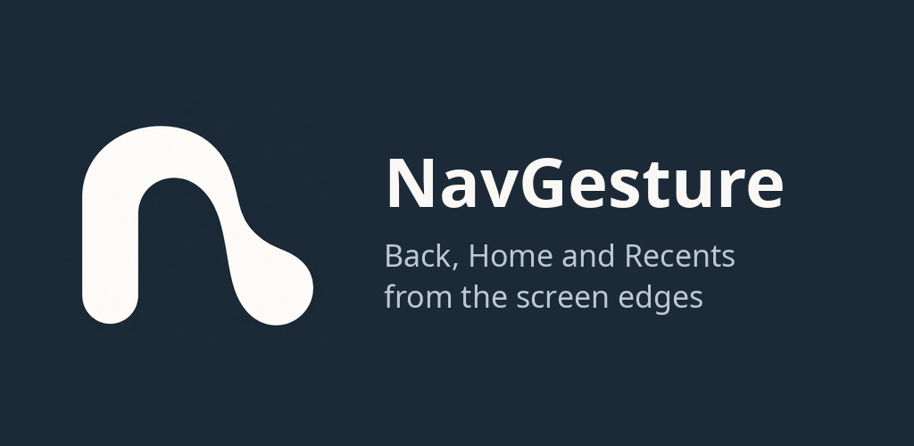
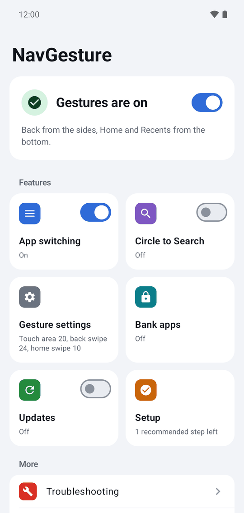
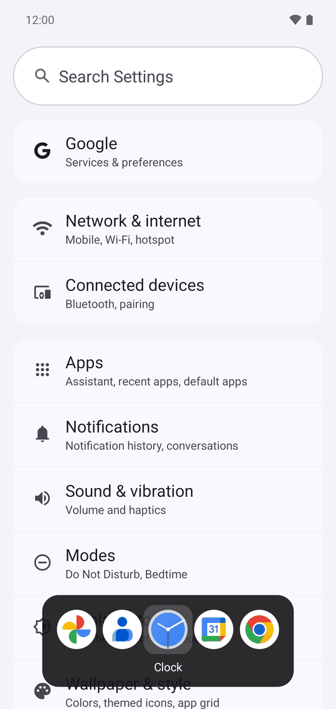
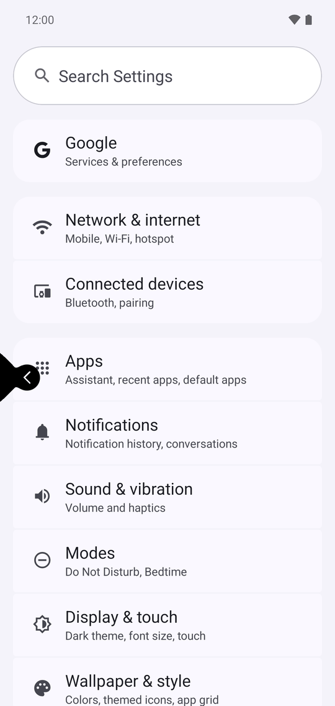
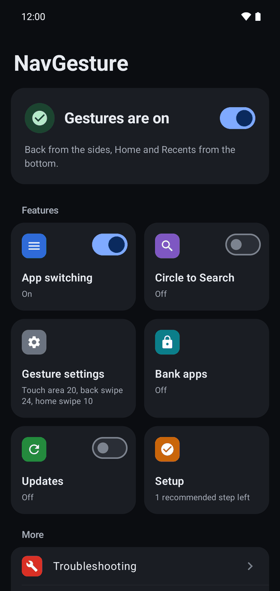
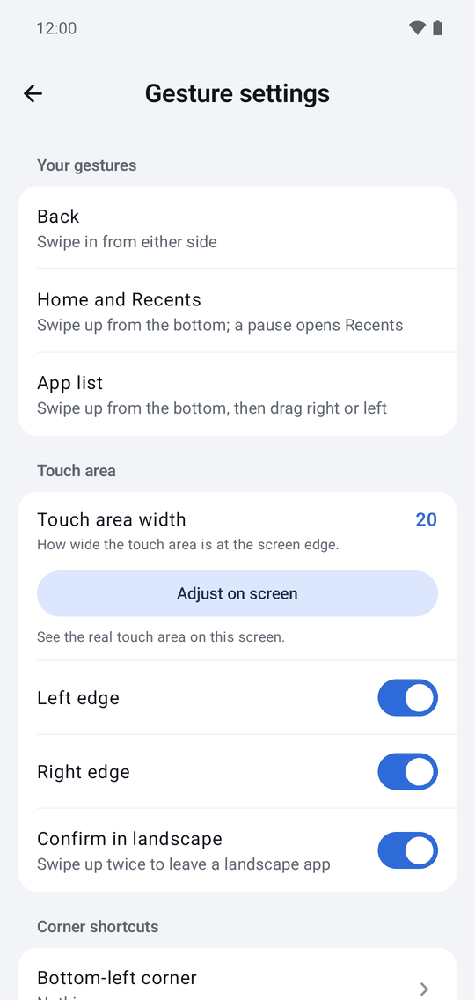
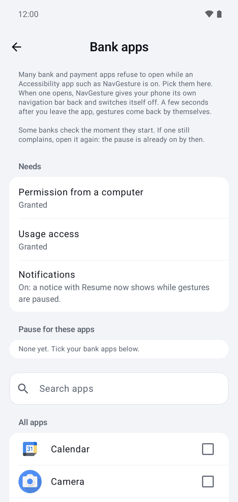

### Edge gestures for Xiaomi HyperOS, so you can keep the launcher you actually like.

**[Download the latest APK](https://github.com/vijayyaso/NavGesture/releases/latest)** · no root · no ADB · no Shizuku · no computer

---

  
  &nbsp;
  
  &nbsp;
  
  &nbsp;
  

## Why NavGesture

HyperOS ties its gesture navigation to the stock launcher. Switch to Nova, Niagara or Lawnchair and the phone drops you back to three buttons.

NavGesture brings the gestures back with one app. It works on any phone with Android 11 or newer, and installs as its own app (`com.vijayyaso.navgesture`).

## Features

<table>
<tr>
<td width="50%" valign="top">

### ⏸️ Recents waits for a real pause
Modelled on the stock POCO launcher (6.01.05). A pause only counts past POCO's own line, about a tenth of the screen up. It is detected the way POCO does it: a smoothed follow point catching up with the finger, not a timer. The pause only *arms* Recents, with a tick. Letting go decides, and a quick flick up is still Home.

</td>
<td width="50%" valign="top">

### 💧 A black drop rises from the edge
A round head joined to the edge by a gooey metaball neck (adapted from Ramotion's MIT-licensed fluid slider), moved by Fluid Navigation Gestures' springs. From the bottom it carries a Home icon. From the sides it carries the Back arrow. It never touches the app underneath. With "Remove animations" on, the drop does not spring or wobble.

</td>
</tr>
<tr>
<td valign="top">

### 🔀 A macOS-style app row
Swipe up from the bottom and drag sideways. A row of app icons appears just above the edge: recent apps when you drag right, your favourites when you drag left. Each drag step (72 dp by default) moves one icon, and the row loops at both ends. Lift to open, or swipe down to close.

</td>
<td valign="top">

### 👆 Tap to pick, if a long swipe is hard
Set the list style to *Tap* and the list stays open after you lift your finger. Touch an app to open it, or touch anywhere else to close. *Both* does either: slide to pick, or lift without sliding and touch.

</td>
</tr>
<tr>
<td valign="top">

### ↗️ Corner shortcuts
Swipe up and inward from a bottom corner, at a slant. That corner runs its shortcut: the app list, notifications, quick settings, a screenshot, lock screen, the power menu, split screen, or any app you pick. A corner without a shortcut keeps working as before.

</td>
<td valign="top">

### 🏦 Bank apps keep working
Many bank and payment apps refuse to open while an Accessibility app is on. Pick them on the Bank apps screen. When one opens, NavGesture gives your phone its own bar back and steps aside. A few seconds after you leave, gestures come back by themselves. Needs the same one-time computer permission as "hide the gesture bar", and usage access.

</td>
</tr>
</table>

## Gestures

| Gesture | Does |
| --- | --- |
| Swipe in from the left or right edge | Back |
| Swipe up from the bottom edge | Home |
| Swipe up from the bottom, pause, then let go | Recent apps |
| Swipe up from the bottom, then drag right | App list: recent apps, one per drag step, loops at both ends |
| Swipe up from the bottom, then drag left | App list: your favourites, one per drag step, loops at both ends |
| Swipe down while the app list is open | Closes the list; nothing opens |
| Swipe up and inward from a bottom corner | That corner's shortcut, once you pick one |
| Touch and hold the middle of the bottom edge | Circle to Search, once it is on |

In landscape the first bottom swipe only shows a pill, and a second one within 2 seconds goes Home, as HyperOS does in games. Recents, corner shortcuts and the app list wait for a second swipe there too. The *Confirm in landscape* switch turns this off.

## Make it yours

Every distance and delay is adjustable. Turn each edge on or off, pick a shortcut for each corner, and choose which bank apps get the pause.

  
  &nbsp;&nbsp;
  

## Install

1. Install `navgesture.apk` from [the latest release](https://github.com/vijayyaso/NavGesture/releases/latest).
2. Allow restricted settings under Settings › Apps › NavGesture › ⋮ › **Allow restricted settings**.
3. Turn it on under Settings › Accessibility › **NavGesture**, then open the app. Its setup checklist covers the rest.

> [!TIP]
> If Play Protect blocks the install, allow restricted settings as in step 2. If the gestures stop, the app's **Troubleshooting** screen has the fixes.

### Two builds, one codebase

| | GitHub release | Google Play (once published) |
| :- | :- | :- |
| Updates | Optional update check against GitHub, off until you turn it on | Through Play |
| Internet permission | Only for that update check | None |

## Privacy

> [!IMPORTANT]
> No ads. No analytics. No account. It never reads the screen or what you type.

- **Edges only.** The accessibility service watches thin strips along the screen edges and turns a swipe into Back, Home, Recents or an app list.
- **No window content.** Its configuration withholds window content.
- **No events, unless you ask.** It takes no accessibility events unless you pick bank apps for bank pause. Then it is told only when one of them opens.
- **Offline by default.** The app goes online only for an update check that stays off until you turn it on. Then it asks GitHub for the latest release.

The full [privacy policy](docs/privacy-policy.md) covers both builds.

## What it can't do

It can't switch on HyperOS's own gesture navigation, since only the system is allowed to do that. It can open the navigation settings so you can hide the three-button bar. [docs/hyperos-navigation.md](docs/hyperos-navigation.md) has the details.

## Built with

- **Kotlin** and **Jetpack Compose** with Material 3
- An `AccessibilityService` plus `TYPE_ACCESSIBILITY_OVERLAY` edge strips, so no "draw over other apps" permission
- **DataStore** for settings, no database
- **Tests:** JUnit over a device-free gesture recognizer, Android lint, shellcheck, SonarQube, and an emulator-driven gesture suite

[docs/development.md](docs/development.md) covers building, testing and releasing.

## Contributors

- Vijayyaso, NavGesture: Recents, the drop, the edge app list and the packaging
- Henrique Almeida ([@h3nc4](https://github.com/h3nc4)), the base of the gesture service
- Victor Eduardo ([@victoresidoro](https://github.com/victoresidoro)), Circle to Search, the Control Center tile, edge to edge and wrapping labels

Circle to Search starts the way [MiCTS](https://github.com/parallelcc/MiCTS) and [CTSLauncher](https://github.com/chenxiaolong/CTSLauncher) do.

## License

GPL-3.0-or-later, see [LICENSE](LICENSE). Copyright (C) 2026 Henrique Almeida and the contributors above. NavGesture is a modified version of [HyperGesture](https://github.com/h3nc4/HyperGesture) by Henrique Almeida. It was forked from HyperGesture commit `0ee6831` (2026-10-23) and has been changed by the NavGesture contributors since then.
